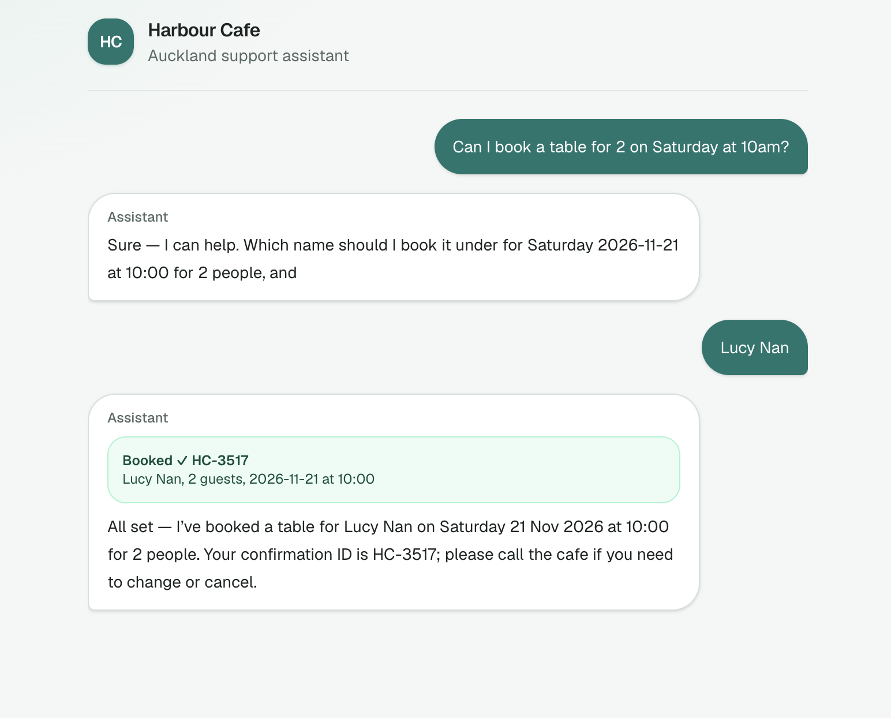

# Harbour Cafe AI Assistant

An AI support chat for a small cafe website in Auckland. It answers questions, checks opening hours and makes table bookings.

**Live demo:** https://ai-support-assistant-zeta.vercel.app/

## Features

- Streaming chat (Vercel AI SDK, `useChat`)
- Tool calling: `getOpeningHours`, `createBooking` (server-side checks with Zod)
- Booking card UI in the chat
- System prompt with guardrails (stays on topic, never invents bookings)
- Rate limit with Upstash Redis (10 messages/min per IP), input and output size limits
- 10 test questions in docs/test-questions.md

## Tech

Next.js (App Router) · TypeScript · Tailwind CSS · Vercel AI SDK · Vercel AI Gateway · Upstash Redis · Vercel

## Run locally

    pnpm install
    cp .env.example .env.local   # then add your keys
    pnpm dev
